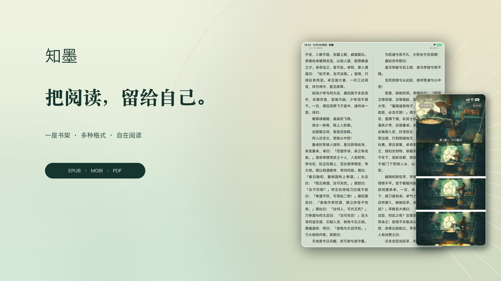

# 知墨 · Zhimor

**让阅读，回归纯粹。** · *A quieter place to read.*

知墨是适用于 iPhone 与 iPad 的多格式电子书阅读器与个人书库。导入、整理和阅读自己的书，按需选择网络存储或 iCloud。

**[知墨官网](https://zzhdong.github.io/Zhimor/)** · **[App Store](https://apps.apple.com/app/id6791544431)** · **[使用指南](https://zzhdong.github.io/Zhimor/guides/)**

## 产品功能

- 多格式本地阅读：支持 TXT、EPUB、MOBI、PDF、DOCX、Markdown、漫画等文件；不同格式采用不同的解析或转换方式。
- 阅读体验：可视化自定义章节标题、双排和传统竖排文字、字体、阅读主题、书签、笔记及阅读统计。
- 自主连接：系统文件导入、局域网 Wi-Fi 传书及可选的网络存储服务。
- 数据管理：可选 iCloud 同步、独立备份与恢复。
- 一次性付费下载；当前版本无订阅、App 内购买或广告，无需知墨账号。

**[隐私政策](https://zzhdong.github.io/Zhimor/privacy/)** · **[技术支持](https://zzhdong.github.io/Zhimor/support/)** · **[开发者邮箱](mailto:zzhdong@gmail.com)**

---

## English

**Zhimor — A quieter place to read.**

A multi-format ebook reader and personal library for iPhone and iPad. Import your books, customise the reading experience, and choose optional network storage or iCloud.

**[Official website](https://zzhdong.github.io/Zhimor/en/)** · **[App Store](https://apps.apple.com/app/id6791544431)** · **[User guides](https://zzhdong.github.io/Zhimor/en/guides/)**

- Read TXT, EPUB, MOBI, PDF, DOCX, Markdown, comics and other supported files; processing methods vary.
- Personalise chapter headings in a visual designer; choose two-column or vertical text layouts, typography, themes, bookmarks, notes and reading insights.
- Import through Files or local Wi-Fi; optionally connect supported network storage.
- Optional iCloud sync and separate backup and restore tools.
- One-time paid download, no subscriptions, in-app purchases, ads or required Zhimor account.

**[Privacy policy](https://zzhdong.github.io/Zhimor/en/privacy/)** · **[Support](https://zzhdong.github.io/Zhimor/en/support/)** · **[Email](mailto:zzhdong@gmail.com)**

© 2026 Zhimor
